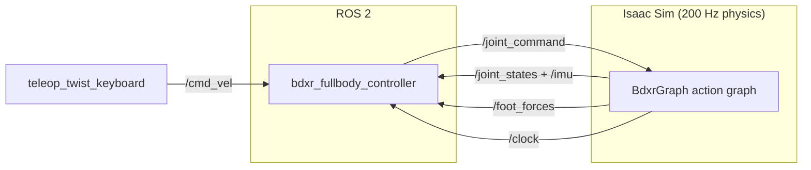

# BDX-R Controller


A ROS 2 node that runs the BDX-R walking policy in Isaac Sim. You send a velocity command, and the node sends joint
targets back to the simulator.

The policy comes from the main project repo, [BDX-R-IsaacLab-Belief](https://github.com/cbergens/BDX-R-IsaacLab-Belief).
That repo trains the policy in Isaac Lab. This repo runs the same policy outside Isaac Lab, through ROS 2, the way a
real robot will run it.

## How it works



Each matched pair of `/joint_states` and `/imu` messages starts one control tick. On every fourth tick, the node builds
the observation and runs the policy. The policy therefore runs at 50 Hz, the same rate as in training.

| Policy | Value |
|---|---|
| Inputs | 295 numbers: 12 observation terms, 5 frames of history each |
| Outputs | 14 joint position offsets: 10 leg joints and 4 head joints |
| Rate | 50 Hz, one policy step for every 4 physics steps |
| File | `bdxr_fullbody_controller/policy/bdxr_policy.pt`, exported from the `head_v10` training run |

## Repo layout

| Path | Contents |
|---|---|
| `bdxr_fullbody_controller/` | The ROS 2 package: node, launch file, policy, and smoke test |
| `sim/BDX-R-Flat-Plane.usda` | The Isaac Sim scene: flat ground, the robot, and the action graph |

## Setup

You need ROS 2 Humble, Isaac Sim 6.1.0, and PyTorch installed for the ROS Python (`/usr/bin/python3`).

The scene loads the robot model from the main repo through a relative path. Clone both repos in this layout:

```text
<root>/
├── BDX-R-Project/
│   └── BDX-R-IsaacLab-Belief/       main repo: training and robot model
└── IsaacSim-ros_workspaces/
    └── humble_ws/src/
        └── BDXR_controller/         this repo
```

Build the package from the workspace:

```bash
cd <root>/IsaacSim-ros_workspaces/humble_ws
colcon build --packages-select bdxr_fullbody_controller
source install/setup.zsh    # use setup.bash in bash
```

## Run

1. Open `sim/BDX-R-Flat-Plane.usda` in Isaac Sim and press Play.
2. Start the controller:

   ```bash
   ros2 launch bdxr_fullbody_controller bdxr_fullbody_controller.launch.xml
   ```

3. Drive the robot from a third terminal:

   ```bash
   ros2 run teleop_twist_keyboard teleop_twist_keyboard --ros-args -p speed:=0.3 -p turn:=0.5
   ```

> [!WARNING]
> Keep commands inside the trained ranges, or the robot can fall. The node does not clamp them yet. The teleop
> defaults of speed 0.5 and turn 1.0 are outside these ranges.

| Command | Trained range |
|---|---|
| Forward `linear.x` | -0.297 to 0.451 m/s |
| Sideways `linear.y` | -0.178 to 0.178 m/s |
| Turn `angular.z` | -0.843 to 0.843 rad/s |

### Launch arguments

| Argument | Default | Meaning |
|---|---|---|
| `policy_path` | the shipped `bdxr_policy.pt` | The TorchScript policy file to load |
| `base_mass` | `7.113365` | Mass of `base_link` in kg. The node warns outside 6.648365 to 8.975365 kg. |
| `use_sim_time` | `true` | Follow the Isaac Sim `/clock` |
| `namespace` | `bdxr_01` | If `use_namespace` is true, the node runs in this ROS namespace. |

## Status

The robot stands and walks in simulation under keyboard control. It drifts right while it walks forward. A test in
Isaac Lab showed the same drift, so the cause is in the policy, not in this node.

- [ ] Clamp `cmd_vel` to the trained ranges
- [ ] Port the joint rate limiter from training
- [ ] Add a head pose command topic
- [ ] Run the policy on the physical robot

## Credits

This node started from NVIDIA's
[H1 fullbody controller example](https://github.com/isaac-sim/IsaacSim-ros_workspaces/tree/main/humble_ws/src/humanoid_locomotion_policy_example/h1_fullbody_controller).
The source files keep its Apache 2.0 license headers.
